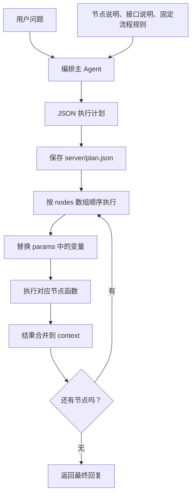

# 8-6 Agent 编排模式

## 一、为什么引入 Agent 编排

**固定工作流**和**可编辑工作流**，都是**由人预先安排执行路径**。即使在入口增加意图判断，预先定义的流程仍然有限；用户提出商品对比、搭配建议等不同需求时，固定导购路径不一定适用。

- 可编辑工作流就是让人预先设置好各个节点的顺序（上节有说到），不同于Agent编排模式

**Agent 编排模式**把已有**工作流节点**拆成**独立函数**，**再**增加可自由请求接口、自由调用大模型的**节点**。用户提出需求后，由一个专门的**编排主 Agent**选择节点、决定顺序和参数，输出 JSON 计划，最后由代码解析并执行。

- 简单理解：大模型根据用户提问和相关节点文档先输出计划，然后代码顺序执行

核心分工：**模型负责规划，代码负责执行，各节点负责具体任务。** 编排主 Agent 自身不直接完成商品查询或筛选。

## 二、整体执行链路



当前实现**一次生成完整计划，再串行执行节点**，没有根据每一步的新结果重新规划的循环。执行前会将计划保存到 `server/plan.json`，便于观察模型实际安排的节点和参数。

## 三、编排主 Agent 如何生成计划

`orchestratorAgent(userQuestion)` 读取 `doc/orchestrator-prompt.md`，把用户问题、节点说明和编排规则一起交给大模型，要求只返回 JSON。

```js
const response = await openai.chat.completions.create({
  model: config.model,
  messages: [{ role: 'user', content: prompt }],
  temperature: 0.3
});
```

这里的 `systemPrompt` 只是一个变量名，**编排请求实际将整份说明放在 `user` 消息中**，没有单独发送 `system` 消息。节点中的 `custom_llm` 则确实使用了 system/user 两种消息角色。

返回文本先通过 `/\{[\s\S]*\}/` 提取 JSON，再使用 `JSON.parse()` 解析。正则中的 `\{`、`\}` 匹配花括号，`[\s\S]*` 匹配包括换行在内的任意内容；它是贪婪匹配，会从第一个 `{` 匹配到最后一个 `}`。这种方式能处理部分附带说明的输出，但不能保证返回值一定是合法计划。

计划的基本结构如下：

```json
{
  "nodes": [
    {
      "name": "get_fashion_guide",
      "params": {},
      "frontendHint": "正在加载穿搭攻略..."
    },
    {
      "name": "ai_select_product",
      "params": { "userQuestion": "{userQuestion}" },
      "frontendHint": "正在分析您的需求..."
    }
  ]
}
```

- `nodes`：按顺序执行的节点列表，不需要上一节的画布坐标和连线。
- `name`：节点类型，对应执行器中的函数。
- `params`：节点所需参数，可以引用前面节点的输出。
- `frontendHint`：给用户看的简短中文进度提示，由编排 Agent 安排。

## 四、五种可用节点

| 节点名称 | 主要输入 | 主要输出 | 实际行为 |
| --- | --- | --- | --- |
| `request_api` | `url`、`method`、`data` 或 `body` | `{ products }` | 请求商品接口，失败时使用本地前 5 个商品 |
| `get_fashion_guide` | 当前不使用参数 | `{ guides }` | 读取 `fashion-guide.md`，缓存攻略内容 |
| `ai_select_product` | `params.userQuestion`、`context.guides` | `{ recommendResult }` | 根据攻略和用户需求选出一个商品名或品类 |
| `ai_filter_products` | `params.count`、上下文中的需求及商品列表 | `{ filteredProducts }` | 从商品列表选择若干商品，默认 3 个 |
| `custom_llm` | `systemPrompt`、`userPromptTemplate`、共享上下文 | `{ response }` | 组织上下文并流式生成最终回复 |

### 请求接口节点

`nodeRequestApi()` 优先使用非空的 `data`，否则使用 `body`。默认请求 `http://localhost:3000/api/query-products`，方法为 POST。如果请求体为空且上下文已有 `recommendResult`，会自动添加 `categories: [context.recommendResult]`。

虽然节点名叫“请求接口”，**当前返回值固定提取为 `{ products }`**，并不是能保留任意接口返回结构的通用工具。当前实现也始终发送 JSON 请求体，没有单独处理 GET 请求的查询参数。

### 攻略与选品节点

`nodeGetFashionGuide()` 从本地读取攻略并缓存，读取失败时返回占位攻略。`nodeAiSelectProduct()` 将用户问题和攻略交给模型，要求只返回商品名称或品类名称；没有攻略或调用失败时，默认推荐“连衣裙”。

### 筛选商品节点

`nodeAiFilterProducts()` 将商品按 1 开始编号，要求模型只返回类似 `1,3,5` 的序号。代码使用 `/\d+/g` 提取数字，转换为数组下标，过滤越界项、去重并限制数量；不足时按原列表顺序补齐，调用失败时返回前 `count` 个商品。

如果商品数量已经不超过 `count`，直接返回全部，不再请求模型。这样可以减少一次不必要的模型调用。

### 自定义上下文节点

`nodeCustomLlm()` 接收主 Agent 指定的 system 和用户提示词，并自动拼接上下文中已有的**攻略、推荐方向、筛选后的商品**。它没有自动拼接原始 `context.products`，因此跳过筛选节点时，要注意最终回复是否真的拿到了商品数据。

它使用 `stream: true` 请求模型，逐块将文本写给前端，同时累积完整文本，最后返回 `{ response: fullResponse }`。

## 五、context 与模板变量替换

上一节使用 `globals` 和按节点 ID 存储的 `nodeResults`；本节使用一个扁平的共享 `context`，将每个节点的输出字段直接合并进去：

```js
for (const node of plan.nodes) {
  const result = await executeNode(node, context, res);
  Object.assign(context, result);
}
```

例如执行导购计划时，上下文会逐步增加：

```js
{
  userQuestion: '推荐适合约会的衣服',
  guides: [...],
  recommendResult: '法式连衣裙',
  products: [...],
  filteredProducts: [...],
  response: '最终生成的推荐回复'
}
```

`replaceTemplateParams(params, context)` 在**每个节点执行前**递归处理参数：

- 字符串：替换 `{变量名}`。
- 数组：递归处理每一项。
- 对象：递归处理每个属性值。
- 数字、布尔值等其他类型：保持不变。

例如：

```js
// 替换前
{ data: { catorgy: '{recommendResult}' } }

// context.recommendResult === '法式连衣裙' 时，替换后
{ data: { catorgy: '法式连衣裙' } }
```

替换规则为 `/\{(\w+)\}/g`：`\w+` 捕获由字母、数字或下划线组成的变量名，`g` 表示替换所有匹配项。它支持 `{userQuestion}`，但不支持 `{products[0].name}` 或 `{nodeResults.node-1}` 等路径表达式。

对象和数组作为变量值时会通过 `JSON.stringify()` 转成字符串，因此 `"{products}"` 替换后是 **JSON 字符串，而非原生数组**。找不到的变量占位符保持原样；同名输出字段再次合并时会覆盖旧值，所以节点顺序和字段命名都很重要。

## 六、executeNode：代码负责真正执行

执行器 `executeNode(node, context, res)` 的步骤是：

1. 解构计划中的 `name`、`params`、`frontendHint`。
2. 对 `params` 做模板替换。
3. 通知前端节点开始。
4. 通过 `switch (name)` 调用对应节点函数，并 `await` 返回结果。
5. 通知前端节点完成，并返回结果供主流程合并。

选品节点若未提供 `userQuestion`，执行器会用 `context.userQuestion` 补齐。未知节点类型当前返回空对象，而不是中止计划。最后一个 `custom_llm` 的回复会成为最终返回值；如果没有生成这类回复，主流程使用默认文字作为最终结果。

## 七、前端进度与流式回复

`sendStageUpdate()` 使用 SSE 格式写出阶段消息：

```text
data: {"type":"stage","stage":"ai_select_product","stageName":"AI选品Agent","status":"start","data":null,"frontendHint":"正在分析您的需求..."}

```

实际发送代码使用 `res.write('data: ' + JSON字符串 + '\n\n')`，两个换行表示一条 SSE 消息结束。

阶段消息中的 `status` 为 `start` 或 `done`，`stageName` 提供中文名称，`frontendHint` 提供用户可读的进度说明；完成时 `data` 携带节点结果。最终生成节点另外发送 `{ type: 'content', content }`，让前端逐块追加回复文本。

节点内部发生错误时多数会返回降级结果，因此收到 `done` 只代表该节点函数已返回，不一定代表接口或模型调用成功。`custom_llm` 出错时返回错误文字，但该 catch 分支没有发送对应的 `content` 事件。

## 八、用固定流程约束自由编排

课件指出：自由度增加以后，可能丢失固定工作流的稳定性。提示词因此要求主 Agent 先识别意图：**命中导购需求时，按预定流程安排节点；其他需求可以自由组合。**

导购流程规定为：

```text
查询攻略 -> AI 选品 -> 请求商品接口 -> AI 筛选商品
```

提示词完整示例还在筛选后增加 `custom_llm`，用于生成面向用户的推荐回复。

需要区分：**当前固定流程是提示词约定，没有代码强制校验**。模型仍可能遗漏或打乱节点。若业务必须严格遵循该流程，可在识别意图后由代码选择固定计划，或校验模型生成的计划是否满足节点顺序和依赖要求。

## 九、与固定工作流、ReAct 的区别

以下是课件对三种模式的概括，实际效果还取决于节点设计和模型能力：

| 模式 | 谁安排执行步骤 | 自由度 | 复杂问题处理 | 稳定性 | 课件举例的适用场景 |
| --- | --- | --- | --- | --- | --- |
| 固定工作流 | 人预先定义流程 | 低 | 较弱 | 最高 | 医院、政府等专业办事 Agent |
| Agent 编排 | 模型先输出计划，代码顺序执行 | 高 | 中等 | 较高 | 客服、企业用户应用等综合服务 |
| ReAct | 模型根据每次工具结果继续决定行动 | 高 | 强 | 一般 | 办公及复杂任务处理 |

本节实现只让主 Agent 规划一次。ReAct 则常见为“思考 → 行动 → 观察结果 → 再思考”的多轮循环，后续决策会使用工具反馈，常需要反复携带历史上下文。本例也有多个节点分别调用模型，但这些调用是在执行预先安排的任务，**不等于主 Agent 在每一步后重新决策**。

## 十、阅读示例时需要留意的实现细节

- 提示词接口说明写的是 `catorgy`，模板示例却使用 `category`，请求节点兜底又使用 `categories`，字段约定不一致。项目的模拟商品接口直接返回固定列表，未按参数筛选，因此暂时掩盖了这个问题；对接真实接口时必须统一。
- 当前直接 `JSON.parse()` 后使用 `plan.nodes`，没有校验数组、节点名称、参数对象和依赖顺序。格式正确的 JSON 也可能不是可执行计划。
- 模板缺失变量不会报错；选品必须先有攻略，筛选必须先有商品。执行前验证这些依赖可以更早发现错误。
- 请求接口节点没有检查 `response.ok`，返回可解析 JSON 的错误响应也可能被当成正常结果。
- 提示词与攻略内容使用进程内缓存，修改文件后当前进程不一定立即重新读取；所有请求也写入同一个 `plan.json`，它不是完整的历史记录。

## 学习重点

**Agent 编排的关键是“节点能力描述 + JSON 计划 + 执行器 + 共享上下文”。** 模型决定如何组合现有能力，代码按计划执行并传递数据；对于必须稳定的业务，用固定流程规则约束编排，并在代码层验证关键要求。


# 编译模式

### 如何是ai对话返回内容支持md格式文档

